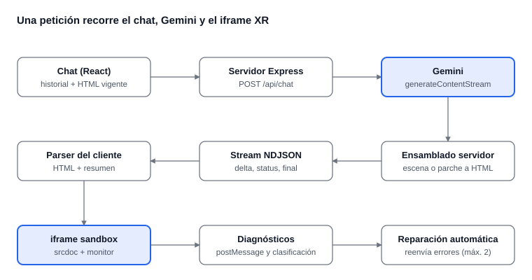

# Arquitectura LLM → XR (profe-ia)

4 de noviembre de 2026

## Visión general

Orbit XR (repositorio `profe-ia`) convierte una conversación en una experiencia WebXR ejecutable. El usuario escribe en un chat React; el servidor Express reenvía el historial a Gemini; el modelo responde con **texto etiquetado** (no con JSON de una API) que el servidor y el cliente interpretan; el resultado es un documento HTML completo que corre en un iframe aislado, desde donde se puede entrar a XR.

Tres ideas sostienen el diseño:

- **Contrato por etiquetas.** El LLM habla un protocolo de texto con cuatro etiquetas: `<webxr-scene>`, `<webxr-html>`, `<webxr-patch>` y `<assistant-response>`. Quién lo define: el `SYSTEM_INSTRUCTION` de `server/src/gemini.ts`.
- **Un solo formato final.** Escenas compactas y parches se compilan en el servidor a un bloque `<webxr-html>` con HTML completo, de modo que el cliente solo conoce ese formato.
- **Bucle de autocorrección.** Un monitor inyectado en el iframe reporta errores reales de ejecución y el cliente los devuelve al modelo hasta 2 veces.



El recuadro resaltado en la fila superior es el único punto que depende del proveedor del LLM; el otro resaltado es donde la experiencia XR realmente se ejecuta.

## Conexión con el LLM

### El punto de enlace

El servidor no depende de Gemini en ningún archivo salvo uno. `server/src/types.ts` define el contrato que el resto del backend consume:

```ts
export type GenerateReply = (
  messages: ChatMessage[],          // { role: "user" | "model", content }
  currentHtml?: string,             // última versión terminada
) => Promise<AsyncIterable<ReplyChunk>>;   // string | { phase: "patching" | "patch-fallback" }
```

`server/src/index.ts` lee la configuración, construye el generador con `createGeminiGenerator(apiKey, model, rawLogDir)` y se lo entrega a `createApp({ generateReply, ... })` en `server/src/app.ts`. Ese es el único punto de acoplamiento real.

### Configuración

| Variable | Uso |
| --- | --- |
| `GEMINI_API_KEY` | Clave de Google AI Studio. Solo la usa el servidor; el cliente nunca la ve. Obligatoria. |
| `GEMINI_MODEL` | Modelo a usar. Por defecto `gemini-3.6-flash`. |
| `ACCESS_PASSWORD` | Contraseña de acceso a la app (cookie `HttpOnly`, sesión de 12 h). Obligatoria. |
| `PORT` | Puerto del servidor (3000 por defecto). |
| `LLM_RAW_DEBUG` | Con `true`, guarda la respuesta cruda del modelo en `.experiments/`. |

### Qué se envía al modelo

- **Historial.** `app.ts` valida el cuerpo (de 1 a 30 mensajes, máximo 8 000 caracteres cada uno, el último debe ser del usuario) y `gemini.ts` lo transforma en `Content[]` con `role` y `parts: [{ text }]`. El cliente solo conserva los resúmenes de las respuestas del modelo, no su HTML.
- **Documento vigente.** Si existe, se anexa al último mensaje del usuario. Si el HTML contiene el bloque `profeia-scene-spec`, se envía como `<current-webxr-scene>` (JSON compacto); si no, como `<current-webxr-html>` con el monitor de errores ya retirado (`stripPreviewMonitor`). Límite: 250 000 caracteres.
- **Instrucción de sistema.** `SYSTEM_INSTRUCTION` (en español) define el rol ("Orbit XR"), las rutas de respuesta, las reglas de seguridad y compatibilidad del HTML, el formato de parches y el protocolo de reparación con `<ERRORS>`.
- **Parámetros.** `temperature: 0.45` y respuesta en streaming con `generateContentStream`.

### Qué hace `/api/chat` con la respuesta

1. Exige sesión válida (si no, 401).
2. Pide el primer fragmento del generador **antes** de abrir el stream HTTP. Si falla o llega vacío, responde un 502 JSON normal en vez de un stream roto.
3. Responde `application/x-ndjson` con un evento JSON por línea: `delta` (texto), `status` (fase), `final` (texto completo ya instrumentado), `done` o `error`.
4. Si el texto acumulado no trae exactamente un bloque `<assistant-response>` no vacío, hace una segunda llamada al modelo pidiendo solo el resumen, sin regenerar la experiencia.
5. Antes de emitir `final`, inyecta el monitor de errores en el HTML (`instrumentGeneratedResponse`).

## Parseo y validación de la respuesta

El modelo no devuelve JSON estructurado de la API: devuelve texto con etiquetas, y el parseo ocurre en dos lugares. Ninguno usa un parser XML; se busca con `indexOf` y expresiones regulares, por eso las etiquetas deben aparecer literalmente y en orden.

### 1. En el servidor (`gemini.ts`, `sceneTemplate.ts`, `patch.ts`)

Al recibir el stream, el generador mira el comienzo de la respuesta y elige un modo:

| La respuesta empieza con | Modo | Qué se hace |
| --- | --- | --- |
| `<webxr-scene>` | escena | Se acumula todo; al terminar se valida el JSON y se renderiza una plantilla A-Frame (`compileSceneResponse`). Se emite un solo bloque `<webxr-html>`. |
| `<webxr-patch>` | parche | Se emite `status: patching`, se acumula y se aplica sobre el documento vigente (`applyPatchResponse`). |
| cualquier otra cosa (`<webxr-html>` o `<assistant-response>`) | libre | Los fragmentos se reenvían tal cual, en streaming. |

**Escena compacta.** `parseSpec` es estricto: versión 1; de 1 a 100 objetos; ids únicos con patrón `^[a-zA-Z][\w-]*$`; formas `box, sphere, cylinder, cone, plane, torus, text, image, model`; vectores de tres números finitos (máximo 10 000 en valor absoluto); colores `#RRGGBB`; URLs solo `https:`; acciones `info, toggle-color, toggle-visibility, spin` con sus campos obligatorios; y destinos (`target`) que existan. El JSON queda incrustado en el HTML final como `<script type="application/json" id="profeia-scene-spec">` para que una petición posterior pueda parchearlo sin reenviar todo el documento.

**Parche sobre escena.** `{"ops": [...]}` con `add`, `update` (un valor `null` borra el campo), `remove` y `setRoot`. El resultado se vuelve a validar y renderizar.

**Parche sobre HTML.** Una o más ediciones `<edit><search>…</search><replace>…</replace></edit>`, aplicadas en orden. Cada `search` debe existir **exactamente una vez**; si no existe o es ambiguo, el parche falla.

**Respaldo automático.** Si la escena o el parche fallan, el servidor no devuelve error al usuario: hace una segunda llamada al modelo con la respuesta fallida, el motivo del error y la orden de responder en formato HTML libre. En el caso del parche emite antes `status: patch-fallback` para que la interfaz lo refleje.

### 2. En el cliente (`client/src/streamParser.ts`, `App.tsx`)

- `WebXrStreamParser` acumula el texto y expone, en cada fragmento, el contenido parcial o completo de `<webxr-html>` y de `<assistant-response>`. Así el código aparece en pantalla mientras se genera.
- Al llegar el evento `final`, el cliente vuelve a parsear el texto completo con un parser nuevo. `finish()` exige un resumen completo y, si hay HTML, que el bloque esté cerrado, aparezca antes del resumen y sea un documento válido (`isCompleteHtmlDocument`: doctype, `html`, `head`, `body` y cierre `</html>`).
- Si hay HTML válido pero falta el resumen, el cliente lo carga igualmente y registra un diagnóstico `missing-response` que activa una corrección.
- El HTML se guarda como "versión vigente" y se envía de nuevo como `currentHtml` en la siguiente petición.

## De la respuesta a la experiencia XR

### Qué es la "experiencia"

Un documento HTML autocontenido (HTML, CSS y JavaScript en un solo archivo) que usa **A-Frame** o **Three.js** cargados desde CDN con versión fija. WebXR no requiere código especial del servidor: el navegador del usuario ofrece la sesión inmersiva (por ejemplo con el botón VR de A-Frame) y el documento la inicia solo a partir de un gesto explícito. Hay dos orígenes del documento:

- **Ruta rápida (escena).** El servidor rellena `renderScene` en `sceneTemplate.ts`: A-Frame 1.8.0, un panel de instrucciones, cámara con controles de escritorio y táctiles, láser en ambas manos para XR, cursor, suelo, luces, y un pequeño script que implementa las acciones `info`, `toggle-color`, `toggle-visibility` y `spin`. Si A-Frame no carga, muestra un aviso.
- **Ruta libre.** El modelo escribe todo el documento. Las reglas del prompt lo acotan: sin imports "bare" (`import ... from "three"`), versiones de CDN explícitas, una sola copia de cada librería, sin `eval`, sin popups ni navegación forzada, interfaz visible que explique cómo entrar a XR y funcionamiento como escena 3D normal si no hay WebXR.

### Cómo se ejecuta

1. `commitCompletedHtml` carga el HTML en un `<iframe srcDoc>` nuevo.
2. El iframe usa `sandbox="allow-scripts allow-forms allow-pointer-lock allow-downloads"` (sin `allow-same-origin`, así el código generado no puede tocar la página padre) y `allow="xr-spatial-tracking; fullscreen; accelerometer; gyroscope"` para habilitar WebXR y sensores.
3. El HTML trae un marcador `__PROFEIA_PREVIEW_RUN_ID__` que el cliente reemplaza por el identificador de la ejecución actual.
4. El usuario puede recargar, abrir a pantalla completa y descargar el archivo.

### El monitor de errores

Después de generar, el servidor inserta un `<script id="profeia-preview-monitor">` justo después de `<head>` (`previewMonitor.ts`). El modelo tiene prohibido escribirlo él mismo. El monitor envía `postMessage` al padre con `namespace: "profeia-preview"` y el `runId`:

- `runtime-error`, `unhandled-rejection` y `resource-error` (script, imagen, hoja de estilo, etc. que no cargan).
- `experience-ready`: cuando `<a-scene>` dispara `loaded` (o en el siguiente frame si no hay A-Frame).

El cliente solo acepta mensajes que vengan de la ventana del iframe y con el `runId` vigente, y los clasifica (`previewDiagnostics.ts`):

| Severidad | Casos |
| --- | --- |
| `ready` | `experience-ready`. Pasados 900 ms sin errores fatales el preview queda listo. |
| `fatal` | Errores de JavaScript, promesas rechazadas, fallo al cargar `script`, `a-asset-item` o hojas de estilo, falta de arranque en 12 s, o falta del resumen. |
| `warning` | Otros recursos que no cargan (por ejemplo una imagen). |
| `ignored` | `ResizeObserver loop`, `AbortError`. |

### Reparación automática

Con un error fatal, el cliente arma un mensaje interno con un bloque `<ERRORS>` (máximo 7 500 caracteres, con las trazas) y lo envía como una petición normal a `/api/chat`, marcada como reparación. El prompt de sistema le indica al modelo que corrija las causas y que prefiera un parche. Se reintenta hasta `MAX_REPAIR_ATTEMPTS = 2` veces; después el estado es `repair-failed`. Los mensajes internos de reparación no se muestran en el chat.

### Experiencia de usuario durante la generación

`BuildOverlay` cubre el iframe con un estado según la fase: azul al generar o revisar, violeta al modificar con un parche y amarillo al reparar. `GhostCode` muestra el código fluyendo, un barrido de revisión y, tras un parche, las líneas que salen en rojo y las que entran en verde. Son recursos visuales; no reflejan la detección real de errores.

## Modelo actual: Gemini

| Aspecto | Valor actual |
| --- | --- |
| SDK | `@google/genai` (declarado como `latest` en `server/package.json`) |
| Modelo | `GEMINI_MODEL`, por defecto `gemini-3.6-flash` |
| Autenticación | `GEMINI_API_KEY` de Google AI Studio, usada solo en el servidor |
| Llamada | `ai.models.generateContentStream({ model, contents, config })` |
| Temperatura | `0.45` |
| Instrucción de sistema | `config.systemInstruction` |
| Salida | Texto en streaming; el código lee `chunk.text` |
| Archivo | `server/src/gemini.ts`, función `createGeminiGenerator` |

### Particularidades de Gemini que aparecen en el código

- **Rol `model`.** Gemini nombra `model` al asistente (no `assistant`). Esa convención se propagó a `ChatRole` en `types.ts`, a la validación de `app.ts` y al cliente, que guarda los mensajes con `role: "model"`.
- **Estructura `Content`.** Cada mensaje se convierte en `{ role, parts: [{ text }] }`.
- **Instrucción de sistema en `config`.** No viaja como mensaje del historial.
- **Reintentos conversacionales.** El respaldo por parche o escena inválida y la petición del resumen faltante añaden turnos `model` y `user` al historial; con Gemini funciona hoy, pero otros proveedores pueden exigir alternancia estricta (ver la sección siguiente).
- **Registro de depuración.** `recordRaw` envuelve el stream y, con `LLM_RAW_DEBUG=true`, escribe el texto crudo en `.experiments/llm-<fecha>.txt`. Es útil para ver exactamente qué etiquetas devolvió el modelo.

### Observación a revisar

En `gemini.ts` el objeto `config` incluye `ThinkingLevel: 0` con mayúscula inicial a nivel raíz. En el SDK de Google el ajuste de razonamiento va dentro de `thinkingConfig` (con `thinkingLevel` o `thinkingBudget`), por lo que esa línea probablemente no tiene efecto: TypeScript no la rechaza porque `config` se declara como variable antes de pasarla. Si se busca controlar el razonamiento, conviene confirmarlo en la documentación de la versión instalada. El `ThinkingLevel` importado tampoco se usa.

### Referencias a "Gemini" fuera del adaptador

Son solo textos, pero conviene tenerlos presentes al cambiar de proveedor: el mensaje de error de `app.ts` ("No se pudo obtener una respuesta de Gemini" y "Gemini devolvió una respuesta vacía"), el de `client/src/streamParser.ts` ("Gemini no devolvió un documento HTML completo"), el nombre del paquete `@gemini-chatbot/server`, las variables `GEMINI_*` y el `README.md`.

## Cómo conectar otro LLM

### Qué no cambia

El cliente completo, `app.ts` (salvo textos), `sceneTemplate.ts`, `patch.ts`, `previewMonitor.ts`, el protocolo NDJSON y el bucle de reparación son independientes del proveedor. Nada fuera de `gemini.ts` e `index.ts` importa el SDK de Google, y los tests del servidor no dependen de él.

### El obstáculo: `gemini.ts` mezcla dos cosas

Hoy el archivo contiene el cliente de Gemini **y** la lógica propia del producto: el prompt de sistema, el anexado del documento vigente, la detección de modo (escena, parche o libre) y el respaldo cuando falla la compilación. Si se escribe un segundo adaptador copiando el archivo, esa lógica queda duplicada. Lo recomendable es separarlas una sola vez:

| Pieza | Dónde vive hoy | Dónde debería vivir |
| --- | --- | --- |
| `SYSTEM_INSTRUCTION` | `gemini.ts` | `server/src/prompt.ts` |
| Anexar `<current-webxr-scene>` o `<current-webxr-html>` al último mensaje | `gemini.ts` | función compartida, antes de llamar al proveedor |
| Detección de modo, compilación y respaldo | `gemini.ts` | `server/src/orchestrator.ts`, parametrizado por una función de streaming |
| Llamada al SDK, conversión de roles, lectura de fragmentos | `gemini.ts` | un adaptador por proveedor |
| Registro crudo (`recordRaw`) | `gemini.ts` | compartido |

La interfaz mínima que debe cumplir un adaptador es esta:

```ts
// Recibe el historial ya preparado y la instrucción de sistema;
// devuelve solo los fragmentos de texto, en orden.
export type StreamText = (
  messages: ChatMessage[],
  systemInstruction: string,
) => Promise<AsyncIterable<string>>;

// El orquestador conserva la lógica actual de gemini.ts y devuelve GenerateReply.
export function createGenerator(streamText: StreamText, rawLogDir?: string): GenerateReply;
```

Con eso, cada proveedor nuevo es un archivo de unas 30 líneas. Boceto (sin probar) para una API compatible con OpenAI:

```ts
import OpenAI from "openai";

export function createOpenAiStream(apiKey: string, model: string, baseURL?: string): StreamText {
  const client = new OpenAI({ apiKey, baseURL });
  return async (messages, systemInstruction) => {
    const stream = await client.chat.completions.create({
      model,
      stream: true,
      temperature: 0.45,
      messages: [
        { role: "system", content: systemInstruction },
        ...messages.map(m => ({
          role: m.role === "model" ? ("assistant" as const) : ("user" as const),
          content: m.content,
        })),
      ],
    });
    return (async function* () {
      for await (const chunk of stream) {
        const text = chunk.choices[0]?.delta?.content;
        if (text) yield text;
      }
    })();
  };
}
```

### Lista de cambios por archivo

| Archivo | Cambio |
| --- | --- |
| `server/src/<proveedor>.ts` (nuevo) | Adaptador `StreamText` del proveedor: cliente, conversión de roles, parámetros y lectura del stream. |
| `server/src/orchestrator.ts` (nuevo) | Mueve aquí lo que no es del proveedor desde `gemini.ts`. |
| `server/src/index.ts` | Elegir el adaptador con una variable (por ejemplo `LLM_PROVIDER=gemini\|openai\|anthropic`) y leer la clave correspondiente en lugar de exigir siempre `GEMINI_API_KEY`. |
| `server/package.json` | Añadir el SDK nuevo y fijar versiones en lugar de `latest`. |
| `.env.example` y `README.md` | Documentar las variables nuevas. |
| `server/src/app.ts` | Cambiar los dos textos que dicen "Gemini" por un mensaje neutro. |
| `client/src/streamParser.ts` | Cambiar el texto "Gemini no devolvió…" por uno neutro. |
| `client/src/types.ts` y `server/src/types.ts` | Opcional: el rol `"model"` es convención de Gemini; puede mantenerse internamente y traducirse solo en el adaptador. |

### Diferencias entre proveedores que hay que cubrir en el adaptador

- **Rol del asistente.** `model` en Gemini; `assistant` en OpenAI y Anthropic.
- **Instrucción de sistema.** Gemini la recibe en `config.systemInstruction`; OpenAI como primer mensaje con rol `system`; Anthropic en el campo `system`.
- **Límite de salida.** Un documento HTML completo es largo. Anthropic exige indicar `max_tokens` y OpenAI limita la salida por defecto según el modelo: hay que fijar un valor suficiente o las respuestas quedarán truncadas y el HTML no cerrará.
- **Alternancia de turnos.** Algunos proveedores exigen alternar `user` y `assistant` y empezar por `user`. El respaldo de `gemini.ts` añade turnos `model` y `user` seguidos del historial, y la petición de resumen envía solo el último mensaje; hay que comprobar que ninguno de los dos viole la regla.
- **Razonamiento.** Cada proveedor lo activa con un parámetro distinto; el que hay hoy (`ThinkingLevel`) es específico de Gemini y debe quedarse en su adaptador.
- **Contexto.** El documento vigente puede llegar a 250 000 caracteres más historial; el modelo elegido debe admitirlo.

### Calidad del contrato por etiquetas

El sistema depende de que el modelo cumpla un formato exacto. Al probar otro modelo conviene vigilar:

1. Que no envuelva la respuesta en bloques de código Markdown (el prompt lo prohíbe) ni añada texto antes de la primera etiqueta: la detección de modo mira el principio de la respuesta.
2. Que los parches usen un `<search>` único y copiado literalmente. Los modelos más pequeños fallan aquí con frecuencia; el respaldo a HTML libre lo cubre, pero cuesta una llamada extra.
3. Que siempre cierre `<assistant-response>`.
4. Que respete las reglas de CDN: versiones fijas y sin imports "bare".

Para depurar, active `LLM_RAW_DEBUG=true` y revise `.experiments/`: allí queda el texto exacto devuelto, antes de cualquier parseo. Si un modelo falla de forma sistemática con las etiquetas, el ajuste se hace en `prompt.ts`, no en los parsers.

### Pasos para la migración

1. Extraer `prompt.ts` y `orchestrator.ts` sin cambiar el comportamiento; ejecutar `npm test`.
2. Convertir `gemini.ts` en un adaptador `StreamText` y comprobar que la app sigue funcionando igual.
3. Añadir el segundo adaptador y la selección por variable de entorno en `index.ts`.
4. Probar con `LLM_RAW_DEBUG=true` tres casos: escena nueva, modificación por parche y reparación con un error forzado.
5. Ajustar límites de salida y prompt según lo observado, y actualizar textos y documentación.
