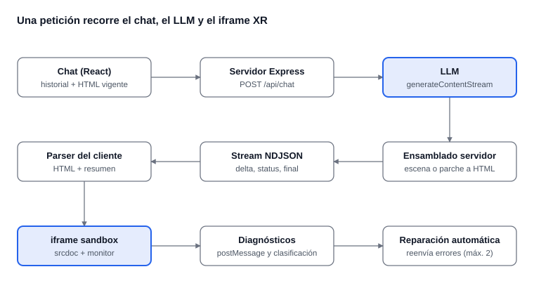

# Arquitectura LLM → XR (profe-ia)

4 de noviembre de 2026 · actualizado el 11 de noviembre de 2026

## Visión general

Orbit XR (repositorio `profe-ia`) convierte una conversación en una experiencia WebXR ejecutable. El usuario escribe en un chat React; el servidor Express reenvía el historial al modelo de lenguaje configurado; el modelo responde con **texto etiquetado** (no con JSON de una API) que el servidor y el cliente interpretan; el resultado es un documento HTML completo que corre en un iframe aislado, desde donde se puede entrar a XR.

Tres ideas sostienen el diseño:

- **Contrato por etiquetas.** El LLM habla un protocolo de texto con cuatro etiquetas: `<webxr-scene>`, `<webxr-html>`, `<webxr-patch>` y `<assistant-response>`. Quién lo define: el `SYSTEM_INSTRUCTION` de `server/src/prompt.ts`.
- **Un solo formato final.** Escenas compactas y parches se compilan en el servidor a un bloque `<webxr-html>` con HTML completo, de modo que el cliente solo conoce ese formato.
- **Bucle de autocorrección.** Un monitor inyectado en el iframe reporta errores reales de ejecución y el cliente los devuelve al modelo hasta 2 veces.



El recuadro resaltado en la fila superior es el único punto que depende del proveedor del LLM; el otro resaltado es donde la experiencia XR realmente se ejecuta.

## Conexión con el LLM

### El punto de enlace

El servidor puede tener varios modelos conectados a la vez y habla con todos a través de una sola interfaz, `LlmProvider` (`server/src/llm/types.ts`):

```ts
interface LlmProvider {
  id: string;     // "claude-cli", "gemini"...
  label: string;  // nombre para la interfaz
  model: string;  // "haiku"
  streamText(request: { system: string; messages: ChatMessage[]; signal?: AbortSignal }): AsyncIterable<string>;
}
```

Un adaptador solo convierte mensajes (`role: "user" | "assistant"`) en texto en streaming. Todo lo demás es independiente del proveedor y se reparte así:

| Pieza | Archivo |
| --- | --- |
| Instrucción de sistema y anexado del documento vigente (`withCurrentExperience`) | `server/src/prompt.ts` |
| Detección de modo, compilación de escenas, aplicación de parches, respaldo a HTML libre y registro crudo (`createGenerator`) | `server/src/orchestrator.ts` |
| Lista de adaptadores (`PROVIDER_DEFINITIONS`) y activación por variables de entorno (`createProviderRegistry`) | `server/src/llm/index.ts` |
| Adaptadores concretos | `server/src/llm/claudeCli.ts`, `server/src/llm/gemini.ts` |

Solo la carpeta `server/src/llm/` conoce proveedores concretos; ningún otro archivo del servidor ni del cliente los nombra.

`server/src/index.ts` crea el registro con `createProviderRegistry(process.env)`, construye `createGenerator(registry.get, { rawLogDir })` y entrega a `createApp` el generador, la lista pública de proveedores y el predeterminado. Cada petición puede pedir un proveedor con el campo `provider`. `app.ts` solo conoce el contrato `GenerateReply` de `server/src/types.ts`:

```ts
export type GenerateReply = (
  messages: ChatMessage[],          // { role: "user" | "assistant", content }
  currentHtml?: string,             // última versión terminada
  options?: { provider?: string },  // id del proveedor; si falta, el predeterminado
) => Promise<AsyncIterable<ReplyChunk>>;   // string | { phase: "patching" | "patch-fallback" }
```

### Configuración

| Variable | Uso |
| --- | --- |
| `LLM_PROVIDERS` | Adaptadores activos, separados por comas. Por defecto el primero registrado (`claude-cli`). |
| `LLM_DEFAULT_PROVIDER` | Adaptador usado si la petición no indica `provider`. Por defecto el primero de la lista. |
| Variables de cada adaptador | `CLAUDE_CLI_MODEL`, `CLAUDE_CLI_PATH`, `CLAUDE_CLI_MAX_OUTPUT_TOKENS`; `GEMINI_API_KEY`, `GEMINI_MODEL`. Ver [api.md](api.md#modelos-de-lenguaje). |
| `ACCESS_PASSWORD` | Contraseña de acceso a la app web (cookie `HttpOnly`, sesión de 12 h). Obligatoria. |
| `API_TOKENS` | Tokens Bearer para clientes externos, `nombre:token,...`. Opcional. Ver [api.md](api.md). |
| `CORS_ORIGINS` | Orígenes de navegador autorizados a llamar a la API. Opcional. |
| `PORT` | Puerto del servidor (3000 por defecto). |
| `LLM_RAW_DEBUG` | Con `true`, guarda la respuesta cruda del modelo en `.experiments/`. |

### Qué se envía al modelo

- **Historial.** `app.ts` valida el cuerpo (de 1 a 30 mensajes, máximo 8 000 caracteres cada uno, el último debe ser del usuario; `"model"` se acepta como alias de `"assistant"`) y lo pasa tal cual al orquestador. El cliente solo conserva los resúmenes de las respuestas del modelo, no su HTML.
- **Documento vigente.** Si existe, `withCurrentExperience` lo anexa al último mensaje del usuario. Si el HTML contiene el bloque `profeia-scene-spec`, se envía como `<current-webxr-scene>` (JSON compacto); si no, como `<current-webxr-html>` con el monitor de errores ya retirado (`stripPreviewMonitor`). Límite: 250 000 caracteres.
- **Instrucción de sistema.** `SYSTEM_INSTRUCTION` (en español) define el rol ("Orbit XR"), las rutas de respuesta, las reglas de seguridad y compatibilidad del HTML, el formato de parches y el protocolo de reparación con `<ERRORS>`.
- **Parámetros.** Los decide cada adaptador; el contrato solo pide texto en streaming.

### Qué hace `/api/chat` con la respuesta

1. Exige un token Bearer de `API_TOKENS` o una sesión web válida (si no, 401; con más de 10 tokens inválidos por IP en 15 minutos, 429).
2. Pide el primer fragmento del generador **antes** de abrir el stream HTTP. Si falla o llega vacío, responde un 502 JSON normal en vez de un stream roto.
3. Responde `application/x-ndjson` con un evento JSON por línea: `delta` (texto), `status` (fase), `final` (texto completo ya instrumentado), `done` o `error`.
4. Si el texto acumulado no trae exactamente un bloque `<assistant-response>` no vacío, hace una segunda llamada al modelo pidiendo solo el resumen, sin regenerar la experiencia.
5. Antes de emitir `final`, inyecta el monitor de errores en el HTML (`instrumentGeneratedResponse`).
6. Con `?stream=false` hace lo mismo pero responde un único JSON `{ response, html, raw }`, pensado para integraciones.

## Parseo y validación de la respuesta

El modelo no devuelve JSON estructurado de la API: devuelve texto con etiquetas, y el parseo ocurre en dos lugares. Ninguno usa un parser XML; se busca con `indexOf` y expresiones regulares, por eso las etiquetas deben aparecer literalmente y en orden.

### 1. En el servidor (`orchestrator.ts`, `sceneTemplate.ts`, `patch.ts`)

Al recibir el stream, el generador mira el comienzo de la respuesta y elige un modo:

| La respuesta empieza con | Modo | Qué se hace |
| --- | --- | --- |
| `<webxr-scene>` | escena | Se acumula todo; al terminar se valida el JSON y se renderiza una plantilla A-Frame (`compileSceneResponse`). Se emite un solo bloque `<webxr-html>`. |
| `<webxr-patch>` | parche | Se emite `status: patching`, se acumula y se aplica sobre el documento vigente (`applyPatchResponse`). |
| cualquier otra cosa (`<webxr-html>` o `<assistant-response>`) | libre | Los fragmentos se reenvían tal cual, en streaming. |

**Escena compacta.** `parseSpec` es estricto: versión 1; de 1 a 100 objetos; ids únicos con patrón `^[a-zA-Z][\w-]*$`; formas `box, sphere, cylinder, cone, plane, torus, text, image, model`; vectores de tres números finitos (máximo 10 000 en valor absoluto); colores `#RRGGBB`; URLs solo `https:`; acciones `info, toggle-color, toggle-visibility, spin` con sus campos obligatorios; y destinos (`target`) que existan. El JSON queda incrustado en el HTML final como `<script type="application/json" id="profeia-scene-spec">` para que una petición posterior pueda parchearlo sin reenviar todo el documento.

**Parche sobre escena.** `{"ops": [...]}` con `add`, `update` (un valor `null` borra el campo), `remove` y `setRoot`. El resultado se vuelve a validar y renderizar.

**Parche sobre HTML.** Una o más ediciones `<edit><search>…</search><replace>…</replace></edit>`, aplicadas en orden. Cada `search` debe existir **exactamente una vez**; si no existe o es ambiguo, el parche falla.

**Respaldo automático.** Si la escena o el parche fallan, el servidor no devuelve error al usuario: hace una segunda llamada al modelo con la respuesta fallida, el motivo del error y la orden de responder en formato HTML libre. En el caso del parche emite antes `status: patch-fallback` para que la interfaz lo refleje.

### 2. En el cliente (`client/src/streamParser.ts`, `App.tsx`)

- `WebXrStreamParser` acumula el texto y expone, en cada fragmento, el contenido parcial o completo de `<webxr-html>` y de `<assistant-response>`. Así el código aparece en pantalla mientras se genera.
- Al llegar el evento `final`, el cliente vuelve a parsear el texto completo con un parser nuevo. `finish()` exige un resumen completo y, si hay HTML, que el bloque esté cerrado, aparezca antes del resumen y sea un documento válido (`isCompleteHtmlDocument`: doctype, `html`, `head`, `body` y cierre `</html>`).
- Si hay HTML válido pero falta el resumen, el cliente lo carga igualmente y registra un diagnóstico `missing-response` que activa una corrección.
- El HTML se guarda como "versión vigente" y se envía de nuevo como `currentHtml` en la siguiente petición.

## De la respuesta a la experiencia XR

### Qué es la "experiencia"

Un documento HTML autocontenido (HTML, CSS y JavaScript en un solo archivo) que usa **A-Frame** o **Three.js** cargados desde CDN con versión fija. WebXR no requiere código especial del servidor: el navegador del usuario ofrece la sesión inmersiva (por ejemplo con el botón VR de A-Frame) y el documento la inicia solo a partir de un gesto explícito. Hay dos orígenes del documento:

- **Ruta rápida (escena).** El servidor rellena `renderScene` en `sceneTemplate.ts`: A-Frame 1.8.0, un panel de instrucciones, cámara con controles de escritorio y táctiles, láser en ambas manos para XR, cursor, suelo, luces, y un pequeño script que implementa las acciones `info`, `toggle-color`, `toggle-visibility` y `spin`. Si A-Frame no carga, muestra un aviso.
- **Ruta libre.** El modelo escribe todo el documento. Las reglas del prompt lo acotan: sin imports "bare" (`import ... from "three"`), versiones de CDN explícitas, una sola copia de cada librería, sin `eval`, sin popups ni navegación forzada, interfaz visible que explique cómo entrar a XR y funcionamiento como escena 3D normal si no hay WebXR.

### Cómo se ejecuta

1. `commitCompletedHtml` carga el HTML en un `<iframe srcDoc>` nuevo.
2. El iframe usa `sandbox="allow-scripts allow-forms allow-pointer-lock allow-downloads"` (sin `allow-same-origin`, así el código generado no puede tocar la página padre) y `allow="xr-spatial-tracking; fullscreen; accelerometer; gyroscope"` para habilitar WebXR y sensores.
3. El HTML trae un marcador `__PROFEIA_PREVIEW_RUN_ID__` que el cliente reemplaza por el identificador de la ejecución actual.
4. El usuario puede recargar, abrir a pantalla completa y descargar el archivo.

### El monitor de errores

Después de generar, el servidor inserta un `<script id="profeia-preview-monitor">` justo después de `<head>` (`previewMonitor.ts`). El modelo tiene prohibido escribirlo él mismo. El monitor envía `postMessage` al padre con `namespace: "profeia-preview"` y el `runId`:

- `runtime-error`, `unhandled-rejection` y `resource-error` (script, imagen, hoja de estilo, etc. que no cargan).
- `experience-ready`: cuando `<a-scene>` dispara `loaded` (o en el siguiente frame si no hay A-Frame).

El cliente solo acepta mensajes que vengan de la ventana del iframe y con el `runId` vigente, y los clasifica (`previewDiagnostics.ts`):

| Severidad | Casos |
| --- | --- |
| `ready` | `experience-ready`. Pasados 900 ms sin errores fatales el preview queda listo. |
| `fatal` | Errores de JavaScript, promesas rechazadas, fallo al cargar `script`, `a-asset-item` o hojas de estilo, falta de arranque en 12 s, o falta del resumen. |
| `warning` | Otros recursos que no cargan (por ejemplo una imagen). |
| `ignored` | `ResizeObserver loop`, `AbortError`. |

### Reparación automática

Con un error fatal, el cliente arma un mensaje interno con un bloque `<ERRORS>` (máximo 7 500 caracteres, con las trazas) y lo envía como una petición normal a `/api/chat`, marcada como reparación. El prompt de sistema le indica al modelo que corrija las causas y que prefiera un parche. Se reintenta hasta `MAX_REPAIR_ATTEMPTS = 2` veces; después el estado es `repair-failed`. Los mensajes internos de reparación no se muestran en el chat.

### Experiencia de usuario durante la generación

`BuildOverlay` cubre el iframe con un estado según la fase: azul al generar o revisar, violeta al modificar con un parche y amarillo al reparar. `GhostCode` muestra el código fluyendo, un barrido de revisión y, tras un parche, las líneas que salen en rojo y las que entran en verde. Son recursos visuales; no reflejan la detección real de errores.

## Adaptadores incluidos

### Claude CLI (`claude-cli`)

| Aspecto | Valor actual |
| --- | --- |
| Adaptador | `claude-cli` (`server/src/llm/claudeCli.ts`) |
| Modelo | `CLAUDE_CLI_MODEL`, por defecto `haiku` |
| Autenticación | La sesión de Claude Code ya iniciada en la máquina; no usa clave de API |
| Llamada | `claude -p --model <modelo> --output-format stream-json --include-partial-messages --system-prompt <prompt>` |
| Aislamiento | `--tools ""`, `--strict-mcp-config`, `--setting-sources ""`, `--no-session-persistence` y directorio de trabajo temporal: el modelo no tiene herramientas ni ve el repositorio |
| Salida | Se leen los eventos `content_block_delta` / `text_delta`; un `result` con `is_error` o un código de salida distinto de 0 se convierten en error |
| Límite de salida | `CLAUDE_CLI_MAX_OUTPUT_TOKENS`, por defecto 64 000 |

Particularidades:

- **Un solo prompt.** `claude -p` recibe un único mensaje por stdin, así que `serializeConversation` convierte el historial en un transcript `<conversation><turn role="...">…</turn></conversation>` seguido del mensaje actual. Con un solo mensaje se envía tal cual.
- **Solo local.** Funciona donde la CLI esté instalada y autenticada. No sirve en Railway: para producción hay que añadir un adaptador con clave de API.
- **Latencia.** Cada petición arranca un proceso nuevo de la CLI (alrededor de un segundo extra).

### Gemini (`gemini`)

| Aspecto | Valor actual |
| --- | --- |
| Adaptador | `server/src/llm/gemini.ts` |
| SDK | `@google/genai` |
| Modelo | `GEMINI_MODEL`, por defecto `gemini-3.6-flash` |
| Autenticación | `GEMINI_API_KEY` de Google AI Studio, usada solo en el servidor |
| Llamada | `ai.models.generateContentStream({ model, contents, config: { systemInstruction, temperature: 0.45, abortSignal } })` |

Gemini llama `model` al rol del asistente; el adaptador traduce `assistant` → `model` y el resto del sistema usa siempre `assistant`.

### Registro de depuración

`recordRaw` (en el orquestador) escribe el texto crudo en `.experiments/llm-<fecha>.txt` con `LLM_RAW_DEBUG=true`, indicando `proveedor/modelo`. Sirve igual para todos los adaptadores.

## Cómo conectar otro LLM

### Qué no cambia

El cliente completo, `app.ts`, `prompt.ts`, `orchestrator.ts`, `sceneTemplate.ts`, `patch.ts`, `previewMonitor.ts`, el protocolo NDJSON, la API para clientes externos y el bucle de reparación son independientes del proveedor. Solo `server/src/llm/` sabe con qué modelos se habla.

### Pasos

1. Crear `server/src/llm/<proveedor>.ts` que exporte un `ProviderDefinition` (`{ id, create(env) }`); `create` lee sus variables (clave, modelo) y lanza un error claro si falta alguna.
2. Añadirlo a `PROVIDER_DEFINITIONS` en `server/src/llm/index.ts`.
3. Añadir el SDK a `server/package.json` y documentar las variables en `.env.example`.
4. Activarlo incluyendo su id en `LLM_PROVIDERS`. Aparecerá en `GET /api/providers` y en el selector del frontend.
5. Probar con `LLM_RAW_DEBUG=true` tres casos: escena nueva, modificación por parche y reparación con un error forzado.

Boceto (sin probar) de un adaptador para una API compatible con OpenAI:

```ts
import OpenAI from "openai";
import type { LlmProvider } from "./types.js";

export function createOpenAiProvider(apiKey: string, model: string, baseURL?: string): LlmProvider {
  const client = new OpenAI({ apiKey, baseURL });
  return {
    id: "openai",
    label: `OpenAI ${model}`,
    model,
    async *streamText({ system, messages, signal }) {
      const stream = await client.chat.completions.create(
        { model, stream: true, messages: [{ role: "system", content: system }, ...messages] },
        { signal },
      );
      for await (const chunk of stream) {
        const text = chunk.choices[0]?.delta?.content;
        if (text) yield text;
      }
    },
  };
}
```

### Diferencias entre proveedores que cubre el adaptador

- **Instrucción de sistema.** Unos la reciben en un campo propio (`system`), otros como primer mensaje con rol `system`.
- **Límite de salida.** Un documento HTML completo es largo. Hay que fijar un límite de tokens suficiente o el HTML quedará truncado y no cerrará.
- **Alternancia de turnos.** El historial que llega al adaptador siempre empieza y termina con `user`. El respaldo del orquestador añade un turno `assistant` y otro `user`, y la petición de resumen envía solo el último mensaje del usuario, la respuesta y la instrucción; ambos respetan la alternancia.
- **Razonamiento y temperatura.** Cada proveedor los configura con parámetros distintos; esos ajustes se quedan dentro de su adaptador.
- **Contexto.** El documento vigente puede llegar a 250 000 caracteres más historial; el modelo elegido debe admitirlo.

### Calidad del contrato por etiquetas

El sistema depende de que el modelo cumpla un formato exacto. Al probar otro modelo conviene vigilar:

1. Que no envuelva la respuesta en bloques de código Markdown (el prompt lo prohíbe) ni añada texto antes de la primera etiqueta: la detección de modo mira el principio de la respuesta.
2. Que los parches usen un `<search>` único y copiado literalmente. Los modelos más pequeños fallan aquí con frecuencia; el respaldo a HTML libre lo cubre, pero cuesta una llamada extra.
3. Que siempre cierre `<assistant-response>`.
4. Que respete las reglas de CDN: versiones fijas y sin imports "bare".

Para depurar, active `LLM_RAW_DEBUG=true` y revise `.experiments/`: allí queda el texto exacto devuelto, antes de cualquier parseo. Si un modelo falla de forma sistemática con las etiquetas, el ajuste se hace en `prompt.ts`, no en los parsers.
